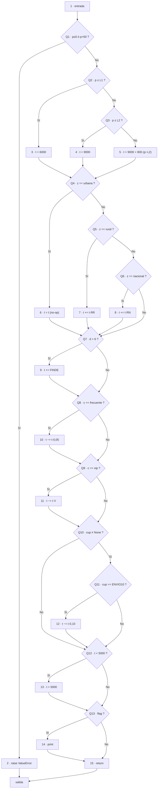
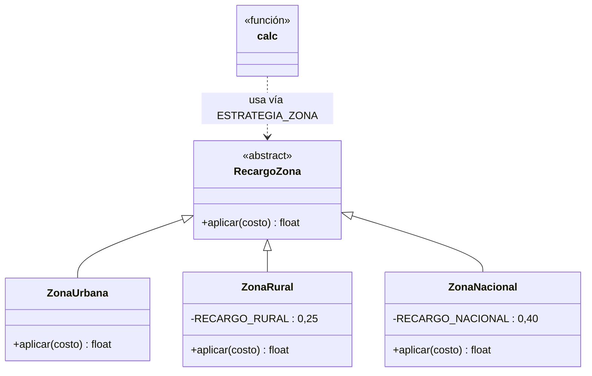

# Parcial 3 - Ingeniería de Software I - EnvíaYa

**Estudiante:** (tu nombre aquí)
**Código estudiantil:** 0182320076
**Grupo B1 · VI semestre · 2026-2 · Tercer corte**

---

## Mis parámetros

Últimos 6 dígitos: **3 2 0 0 7 6** → A=3, B=2, C=0, D=0, E=7, F=6

| A | B | C | D | E | F | PMAX | L1 | L2 | RR | RN | V | S | CAMBIO |
|---|---|---|---|---|---|------|----|----|----|----|---|---|--------|
| 3 | 2 | 0 | 0 | 7 | 6 | 45 kg | 4 kg | 10 kg | 25 % | 40 % | 10 % | $2.000 | 0 |

**Reglas personalizadas:**
- D = 0 (par) → Tramo 1 **incluye** el límite: `peso ≤ 4`
- E = 7 (impar) → Recargo de fin de semana **después** de los descuentos
- B = 2 (par) → Solo se aplica **el mayor** descuento
- F = 6 (par) → Cupón inexistente **se ignora**
- CAMBIO = 0 → Parte 8: Nueva zona insular (San Andrés), +70 %, sin cupón

---

## Parte 1 · Requisitos y criterios de aceptación (0,4 pts)

### Especificación R1–R8 (con mis números)

- **R1:** 0 < peso ≤ **45** kg; si no, error "peso inválido".
- **R2:** zona ∈ {urbana, rural, nacional}; día ∈ 1..7; si no, error.
- **R3:** Tramo 1 (peso ≤ **4**, incluido): $6.000. Tramo 2 (4 < peso ≤ **10**, incluido): $9.000. Peso > 10: $9.000 + $800 × (peso − 10), proporcional.
- **R4:** Rural: +**25 %**. Nacional: +**40 %**. Urbana: sin recargo.
- **R5:** Sábado (6) y domingo (7): +**$2.000**, sumado **después** de los descuentos (E impar).
- **R6:** Frecuente: 5 %. VIP: **10 %**. Cupón ENVIO10: 10 %. Con dos: solo **el mayor** (B par).
- **R7:** Cupón inexistente: **se ignora** (F par).
- **R8:** Costo mínimo $5.000. Redondeo al múltiplo de $100 más cercano; $50 hacia arriba.

### Historias de usuario (Dado / Cuando / Entonces)

**HU1 · Costo por peso del paquete (cubre R1, R3, R8)**
Como cliente de EnvíaYa, quiero que el costo de mi envío dependa del peso del
paquete en tramos, para pagar exactamente lo que corresponde a su tamaño.

Criterios de aceptación:
- **Dado** un peso de 4 kg (igual a mi L1), **cuando** calculo el costo con zona
  urbana y cliente normal, **entonces** se cobra el tramo 1: $6.000 (mi regla D,
  par, incluye el límite: peso ≤ 4).
- **Dado** un peso de 4,1 kg, **cuando** calculo el costo, **entonces** se cobra el
  tramo 2: $9.000 (ya superó L1 = 4).
- **Dado** un peso de 15 kg, **cuando** calculo el costo, **entonces** se cobra
  $9.000 + $800 × (15 − 10) = $13.000 (proporcional sobre L2 = 10).
- **Dado** un peso de 45,5 kg (mayor que mi PMAX = 45), **cuando** calculo el
  costo, **entonces** se lanza el error "peso inválido".
- **Dado** un peso de 0 kg o negativo, **cuando** calculo el costo, **entonces**
  se lanza el error "peso inválido".

**HU2 · Recargo por zona de destino (cubre R2, R4, R8)**
Como cliente de EnvíaYa, quiero que el costo incluya el recargo según la zona
de destino, para que el precio refleje el costo real de llevar el paquete allí.

Criterios de aceptación:
- **Dado** un envío a zona rural (mi RR = 25 %), **cuando** calculo el costo de
  un paquete de 10 kg, **entonces** el costo es 9.000 × 1,25 = $11.250, que
  redondeado al múltiplo de $100 más cercano (50 hacia arriba, R8) es **$11.300**.
- **Dado** un envío a zona nacional (mi RN = 40 %), **cuando** calculo el costo
  de un paquete de 10 kg, **entonces** el costo es 9.000 × 1,40 = **$12.600**.
- **Dado** un envío a zona urbana, **cuando** calculo el costo, **entonces** no
  se aplica ningún recargo por zona.
- **Dado** una zona que no es urbana, rural ni nacional, **cuando** calculo el
  costo, **entonces** se lanza un error (R2).
- **Dado** un día fuera del rango 1 a 7, **cuando** calculo el costo, **entonces**
  se lanza un error (R2).

**HU3 · Cliente, cupón y fin de semana (cubre R5, R6, R7, R8)**
Como cliente de EnvíaYa, quiero que se apliquen correctamente mi descuento de
cliente, mi cupón y el recargo de fin de semana, para pagar lo justo en cada
promoción.

Criterios de aceptación (reglas B, E y F mías):
- **Dado** un cliente vip (V = 10 %) con cupón ENVIO10 (10 %), **cuando** calculo
  el costo de un paquete de 4 kg en zona urbana un miércoles, **entonces** solo
  se aplica **el mayor** descuento (mi regla B, par) → 6.000 × 0,90 = **$5.400**.
- **Dado** un envío el sábado (día 6) con cliente vip, **cuando** calculo el
  costo, **entonces** el recargo de fin de semana (+$2.000, R5) se suma **después**
  de los descuentos (mi regla E, impar) → 6.000 × 0,90 + 2.000 = **$7.400**.
- **Dado** un cupón que no existe (por ejemplo "BIENVENIDA"), **cuando** calculo
  el costo, **entonces** el cupón se ignora y el costo no cambia (mi regla F,
  par, R7).
- **Dado** un cálculo cuyo valor antes del redondeo fuera menor a $5.000,
  **cuando** obtengo el resultado, **entonces** el costo final nunca es menor
  que $5.000 y se entrega redondeado al múltiplo de $100 (R8).

### Matriz de trazabilidad

| Requisito | Historia | Casos de prueba (se completan en la Parte 3) |
|---|---|---|
| R1 (peso válido, PMAX=45) | HU1 | CN-… |
| R2 (zona y día válidos) | HU2 | CN-… |
| R3 (tarifa base, L1=4, L2=10) | HU1 | CN-… |
| R4 (recargo zona RR=25 %, RN=40 %) | HU2 | CN-… |
| R5 (finde +$2.000 después de descuentos) | HU3 | CN-… |
| R6 (descuentos, solo el mayor) | HU3 | CN-… |
| R7 (cupón inexistente se ignora) | HU3 | CN-… |
| R8 (mínimo $5.000 y redondeo a $100) | HU1, HU2, HU3 | CN-… |

Cada requisito está cubierto por al menos una historia, y cada historia se
verificará con casos de prueba de la matriz de la Parte 3.

---

## Parte 2 · Plan de pruebas (0,5 pts)

**Producto:** función `calc(p, z, c, d, cup, flag)` del sistema de costos de EnvíaYa (Riohacha).
**Especificación de referencia:** R1–R8 con mis parámetros (PMAX=45, L1=4, L2=10, RR=25 %, RN=40 %, V=10 %, S=$2.000; reglas D/E/B/F según mis dígitos).
**Objetivo:** verificar que el código heredado v1.0.0 cumple la especificación, registrar los defectos, y validar el código corregido y refactorizado mediante regresión.

### Alcance

- **Dentro:** la lógica de cálculo del costo (validaciones de peso/zona/día, tramos, recargos de zona, fin de semana, descuentos y cupón, mínimo y redondeo).
- **Fuera:** interfaces de usuario, persistencia/base de datos, servicios externos de mensajería, rendimiento y seguridad (la función es pura y local).

### Niveles de prueba aplicados al caso

| Nivel | ¿Cómo se aplica a EnvíaYa? | Evidencia |
|---|---|---|
| **Unidad** | Probar `calc` función por función: cada regla R1–R8 con sus particiones, límites (0, 4, 10, 45) y tabla de decisión cliente×cupón×finde. Es el nivel central de este parcial. | Suite pytest `tests/test_envios.py` |
| **Integración** | Verificar la composición correcta de las reglas en un mismo cálculo: tramo → recargo de zona → descuentos → finde → mínimo → redondeo, en el orden que exige la especificación (es donde el heredado falla: orden de finde y descuentos). | Casos combinados de la matriz (p. ej. rural+vip+sábado+cupón) |
| **Sistema** | Ejecutar el flujo completo como lo usaría el sistema de EnvíaYa: lote de envíos representativos de una jornada (todos los tramos, zonas, clientes y días 1–7) por la API pública de `envios.py`. | Matriz de ≥20 casos ejecutada contra el módulo completo |
| **Aceptación** | Validar contra los criterios Dado/Cuando/Entonces de HU1–HU3 (Parte 1), simulando la aprobación del dueño del negocio. Los resultados esperados se calcularon a mano. | Mapeo HU ↔ casos en la matriz de trazabilidad |

### Estrategia, ambiente y roles

- **Estrategia:** pruebas basadas en especificación (caja negra: particiones de equivalencia, valores límite y tablas de decisión) reforzadas con caja blanca (grafo de flujo, complejidad ciclomática y caminos independientes). Automatización con pytest + pytest-cov. Ciclo: diseño de casos → ejecución contra el heredado → reporte de defectos → corrección/refactor → regresión completa.
- **Ambiente:** Python 3.14 en Windows, pytest 9.1.1, pytest-cov 7.1.0, Git/GitHub. Ejecución local con `python -m pytest tests/ -v` y cobertura con `--cov=envios --cov-branch`.
- **Roles (equipo de calidad de EnvíaYa):** analista de pruebas (diseño de particiones y tabla de decisión — yo), automatizador (suite pytest y cobertura — yo), gestor de configuración (ramas, etiquetas, CHANGELOG — yo). El docente actúa como cliente en la aceptación.

### Riesgos y mitigación

| Riesgo | Prob. | Impacto | Mitigación |
|---|---|---|---|
| Resultados esperados mal calculados a mano (descuentos encadenados, orden del finde) | Alta | Alto | Calcular cada caso paso a paso y revisar contra el ejemplo de referencia del documento; los casos dudosos se marcan y re-verifican |
| Confusión entre la especificación propia y el comportamiento del heredado (asumir que el código es la verdad) | Alta | Alto | La especificación R1–R8 es la única fuente de verdad; toda diferencia se registra como defecto, no como "comportamiento normal" |
| Errores de paridad en mis reglas D/E/B/F al diseñar casos | Media | Alto | Tabla "Mis parámetros" fijada al inicio del informe y en CONFIG; cada caso cita la regla que usa |
| Cobertura insuficiente con pocas pruebas | Media | Medio | Mínimo 20 casos + caminos independientes de la caja blanca; medir cobertura de sentencias y ramas |
| Redondeo ($50 arriba) y mínimo $5.000 pasados por alto | Media | Medio | Casos dedicados de R8 en valores que terminan exactamente en $x50 |

### Criterios de entrada y salida

**Entrada (para iniciar las pruebas):**
1. Especificación R1–R8 completa y congelada con mis parámetros.
2. Código heredado v1.0.0 etiquetado y CONFIG lleno.
3. Matriz de casos diseñada con resultados esperados calculados a mano.
4. Ambiente de pruebas operativo (pytest y pytest-cov instalados).

**Salida (para dar por terminadas las pruebas):**
1. 100 % de los casos de la matriz ejecutados, con resultado PASSED/FAILED registrado.
2. Todos los defectos reportados con ID, severidad y prioridad.
3. Cobertura de sentencias y de ramas medida y documentada.
4. Tras la corrección (Parte 6): regresión completa en verde y cobertura ≥ antes de la corrección.

---

## Parte 3 · Caja negra (0,9 pts)

### 3.1 Particiones de equivalencia

**Entrada: peso (kg, admite decimales)**

| # | Partición | Rango | Válida | Resultado esperado |
|---|---|---|---|---|
| P1 | Peso no válido | p ≤ 0 | No | Error "peso inválido" (R1) |
| P2 | Tramo 1 | 0 < p ≤ 4 | Sí | $6.000 (R3, L1 incluido) |
| P3 | Tramo 2 | 4 < p ≤ 10 | Sí | $9.000 (R3) |
| P4 | Tramo proporcional | 10 < p ≤ 45 | Sí | 9.000 + 800×(p−10) (R3) |
| P5 | Peso no válido (alto) | p > 45 | No | Error "peso inválido" (R1) |

**Entrada: zona**

| # | Partición | Valores | Válida |
|---|---|---|---|
| P6 | Urbana | "urbana" | Sí — sin recargo (R4) |
| P7 | Rural | "rural" | Sí — +25 % (R4) |
| P8 | Nacional | "nacional" | Sí — +40 % (R4) |
| P9 | Cualquier otra | "lunar", "", etc. | No — error (R2) |

**Entrada: día**

| # | Partición | Valores | Válida |
|---|---|---|---|
| P10 | Entre semana | 1–5 | Sí — sin recargo de finde |
| P11 | Sábado | 6 | Sí — +$2.000 después de descuentos (R5, E impar) |
| P12 | Domingo | 7 | Sí — +$2.000 después de descuentos (R5) |
| P13 | Fuera de rango | 0, 8, negativos | No — error (R2) |

**Entrada: cliente**

| # | Partición | Valores | Válida |
|---|---|---|---|
| P14 | Normal | "normal" | Sí — sin descuento |
| P15 | Frecuente | "frecuente" | Sí — 5 % (R6) |
| P16 | VIP | "vip" | Sí — 10 % (R6) |

**Entrada: cupón**

| # | Partición | Valores | Válida |
|---|---|---|---|
| P17 | Sin cupón | None | Sí |
| P18 | ENVIO10 | "ENVIO10" | Sí — 10 % (R6) |
| P19 | Cupón inexistente | "BIENVENIDA", etc. | Sí (input aceptado) — **se ignora** (R7, F par) |

> **Nota de análisis:** la especificación (R2) solo exige error para zona y día inválidos; no define el comportamiento con un cliente no reconocido. Se documenta esta omisión: con cliente desconocido el sistema no aplica descuento (se asiste como "normal"), y se deja registrado como posible mejora (solicitud de cambio futura).

### 3.2 Valores límite de peso

Mi L1 = 4 con regla D **par → límite INCLUIDO** (peso ≤ 4 va al tramo 1):

| Borde | Valor límite | Justo dentro | Justo fuera | R3 |
|---|---|---|---|---|
| Inferior | 0 | 0,1 → $6.000 | 0 → error | R1 |
| L1 | 4 (incluido) | 4 → $6.000 | 4,01 → $9.000 | R3 |
| L2 | 10 (incluido) | 10 → $9.000 | 10,01 → 9.000+800×0,01=$9.008→$9.000 (R8) | R3 |
| PMAX | 45 (incluido) | 45 → 9.000+800×35=$37.000 | 45,01 → error | R1, R3 |

### 3.3 Tabla de decisión · cliente × cupón × fin de semana

Reglas mías: **B par** → solo el mayor descuento; **E impar** → finde se suma DESPUÉS de descuentos; **F par** → cupón inexistente se ignora.

Por F par, "cupón inexistente" es equivalente a "sin cupón" (misma acción), lo que reduce la tabla a 12 reglas:

| # | Cliente | Cupón | Finde | Descuento aplicado | Recargo finde | Acción |
|---|---|---|---|---|---|---|
| D1 | normal | ninguno | no | — | — | base |
| D2 | normal | ninguno | sí | — | +$2.000 al final | base + finde |
| D3 | normal | ENVIO10 | no | 10 % | — | base × 0,90 |
| D4 | normal | ENVIO10 | sí | 10 % | +$2.000 al final | (base × 0,90) + 2.000 |
| D5 | frecuente | ninguno | no | 5 % | — | base × 0,95 |
| D6 | frecuente | ninguno | sí | 5 % | +$2.000 al final | (base × 0,95) + 2.000 |
| D7 | frecuente | ENVIO10 | no | **10 % (el mayor de 5 %/10 %)** | — | base × 0,90 |
| D8 | frecuente | ENVIO10 | sí | 10 % | +$2.000 al final | (base × 0,90) + 2.000 |
| D9 | vip | ninguno | no | 10 % | — | base × 0,90 |
| D10 | vip | ninguno | sí | 10 % | +$2.000 al final | (base × 0,90) + 2.000 |
| D11 | vip | ENVIO10 | no | 10 % (empate: mayor) | — | base × 0,90 |
| D12 | vip | ENVIO10 | sí | 10 % | +$2.000 al final | (base × 0,90) + 2.000 |

En **todas** las reglas: el recargo de finde se aplica después del descuento (E impar) y antes del mínimo/redondeo (R8).

### 3.4 Matriz de casos de prueba (24 casos)

| ID | Requisito | Peso | Zona | Cliente | Día | Cupón | Esperado | Técnica |
|---|---|---|---|---|---|---|---|---|
| CN-01 | R3 | 2 | urbana | normal | 3 | — | $6.000 | Partición P2 (interior) |
| CN-02 | R3 | 4 | urbana | normal | 3 | — | $6.000 | Valor límite L1 (incluido, D par) |
| CN-03 | R3 | 4,01 | urbana | normal | 3 | — | $9.000 | Valor límite L1+ε |
| CN-04 | R3 | 10 | urbana | normal | 3 | — | $9.000 | Valor límite L2 (incluido) |
| CN-05 | R3, R8 | 10,5 | urbana | normal | 3 | — | $9.400 | Partición P4 (interior, proporcional) |
| CN-06 | R1, R3 | 45 | urbana | normal | 3 | — | $37.000 | Valor límite PMAX (incluido) |
| CN-07 | R1 | 45,01 | urbana | normal | 3 | — | Error | Valor límite PMAX+ε |
| CN-08 | R1 | 0 | urbana | normal | 3 | — | Error | Valor límite inferior |
| CN-09 | R1 | 0,1 | urbana | normal | 3 | — | $6.000 | Valor límite 0+ε |
| CN-10 | R4 | 2 | rural | normal | 3 | — | $7.500 | Partición P7 (rural +25 %) |
| CN-11 | R4 | 2 | nacional | normal | 3 | — | $8.400 | Partición P8 (nacional +40 %) |
| CN-12 | R2 | 2 | lunar | normal | 3 | — | Error | Partición P9 (zona inválida) |
| CN-13 | R2 | 2 | urbana | normal | 0 | — | Error | Partición P13 (día inválido) |
| CN-14 | R2 | 2 | urbana | normal | 8 | — | Error | Partición P13 (día inválido) |
| CN-15 | R5 | 2 | urbana | normal | 6 | — | $8.000 | Partición P11 (sábado) |
| CN-16 | R5 | 2 | urbana | normal | 7 | — | $8.000 | Partición P12 (domingo) |
| CN-26 | R5, R6 | 2 | urbana | vip | 7 | — | $7.400 | Tabla decisión D10 (finde después de descuento, E impar) |
| CN-17 | R6 | 2 | urbana | frecuente | 3 | — | $5.700 | Partición P15 (5 %) |
| CN-18 | R6 | 2 | urbana | vip | 3 | — | $5.400 | Partición P16 (10 %) |
| CN-19 | R6 | 2 | urbana | normal | 3 | ENVIO10 | $5.400 | Partición P18 (cupón 10 %) |
| CN-20 | R6 | 2 | urbana | vip | 3 | ENVIO10 | $5.400 | Tabla decisión D11 (solo el mayor, B par) |
| CN-21 | R6 | 2 | urbana | frecuente | 3 | ENVIO10 | $5.400 | Tabla decisión D7 (mayor de 5 %/10 %) |
| CN-22 | R5, R6 | 2 | urbana | vip | 6 | ENVIO10 | $7.400 | Tabla decisión D12 (finde después, E impar) |
| CN-23 | R7 | 2 | urbana | normal | 3 | BIENVENIDA | $6.000 | Partición P19 (cupón ignorado, F par) |
| CN-24 | R3,R4,R5,R6,R8 | 4 | rural | vip | 6 | ENVIO10 | $8.800 | Integración de todas las reglas (caso ejemplo) |

Cobertura: todas las particiones P1–P19 y todas las reglas D1–D12 de la tabla de decisión tienen al menos un caso; los bordes 0/L1/L2/PMAX se prueban por dentro y por fuera.

### 3.5 Cálculo paso a paso de 5 casos (a mano, con mis parámetros)

**CN-24** · peso=4, rural, vip, sábado (6), cupón=ENVIO10
1. Tramo: 4 ≤ 4 (D par, incluido) → tramo 1 = $6.000.
2. Zona rural +25 % → 6.000 × 1,25 = $7.500.
3. Descuentos (B par, solo el mayor): VIP 10 % vs cupón 10 % → 10 % → 7.500 × 0,90 = $6.750.
4. Fin de semana DESPUÉS de descuentos (E impar) → 6.750 + 2.000 = $8.750.
5. ≥ $5.000; redondeo a $100 con 50 hacia arriba → **$8.800**.

**CN-05** · peso=10,5, urbana, normal, miércoles
1. 10,5 > 4 → tramo 2 no: supera L2 → 9.000 + 800 × (10,5 − 10) = 9.000 + 400 = $9.400.
2. Urbana sin recargo; no finde; sin descuentos → $9.400. Redondeo → **$9.400**.

**CN-06** · peso=45 (justo en PMAX), urbana, normal, miércoles
1. 45 ≤ 45 → válido (R1).
2. 45 > 10 → 9.000 + 800 × 35 = 9.000 + 28.000 = $37.000. Redondeo → **$37.000**.

**CN-25** · peso=10, rural, normal, miércoles (caso del redondeo R8)
1. 10 ≤ 10 → tramo 2 = $9.000.
2. Rural +25 % → 9.000 × 1,25 = $11.250.
3. Sin descuentos ni finde. Redondeo: 11.250 termina en 50 → hacia arriba → **$11.300** (el código heredado trunca a $11.200 → defecto).

**CN-22** · peso=2, urbana, vip, sábado, cupón=ENVIO10 (orden del finde, E impar)
1. Tramo 1 = $6.000. 2. Urbana sin recargo.
3. Solo el mayor (B par): 10 % → 6.000 × 0,90 = $5.400.
4. Finde DESPUÉS: 5.400 + 2.000 = $7.400. Redondeo → **$7.400**.
(El heredado no cobra finde el sábado y además aplicaría doble descuento → dos defectos en un solo caso.)

### 3.6 Análisis adicional del mínimo (R8)

Con mi especificación el mínimo de $5.000 nunca se alcanza: la base más pequeña es el tramo 1 ($6.000) y el descuento máximo es 10 % (B par) → mínimo posible $5.400. La regla R8 queda como salvaguarda defensiva; igualmente existe en el código y se mantiene en la refactorización.

---

## Parte 4 · Caja blanca (0,6 pts)

Análisis sobre el código heredado v1.0.0 (`envios.py`), tal como pide el documento, sin corregirlo todavía.

### 4.1 Grafo de flujo de `calc`

Bloques (sentencias): **N1–N15**. Nodos de decisión (predicado): **Q1–Q13**. Nodo de salida: **X**.



La rama "No" de **Q6** no ejecuta ningún bloque (zona no reconocida sigue silenciosamente): eso explica por qué el heredado no lanza error con zona inválida (defecto de R2).

### 4.2 Complejidad ciclomática V(G) — tres formas

Conteo: **N = 29 nodos** (15 bloques + 13 predicados + salida), **E = 41 aristas**, **P = 13 nodos predicado** (Q1 compone `p≤0 ó p>50` en una sola decisión).

| Método | Cálculo | V(G) |
|---|---|---|
| 1 · Aristas y nodos | E − N + 2 = 41 − 29 + 2 | **14** |
| 2 · Nodos predicado | P + 1 = 13 + 1 | **14** |
| 3 · Regiones | 13 regiones encerradas + 1 región exterior | **14** |

Las tres formas coinciden: **V(G) = 14**, un valor alto para una función de una sola responsabilidad — evidencia cuantitativa de la deuda técnica que se atacará en la Parte 6 (tras extraer funciones, la complejidad se reparte entre unidades de V(G) menor).

> Nota: si se descompone la condición compuesta de Q1 en dos predicados simples, V(G) subiría a 15; se adopta el criterio estándar de un nodo de decisión por punto de ramificación.

### 4.3 Caminos independientes y su caso de prueba

Camino base (CB): Q1-No → Q2-No → Q3-No (proporcional) → Q4/Q5/Q6 No (zona inválida) → Q7-No → Q8-No → Q9-No → Q10-No → Q12-No → Q13-No → return. A partir de él, 13 desviaciones, una por decisión:

| # | Camino independiente (difiere del base en) | Caso de prueba | Entradas → esperado |
|---|---|---|---|
| 1 | Q1-Sí (peso inválido) | CN-08 | (0, urbana, normal, 3) → error |
| 2 | Q2-Sí (tramo 1) | CN-01 | (2, urbana, normal, 3) → $6.000 |
| 3 | Q3-Sí (tramo 2) | CN-04 | (10, urbana, normal, 3) → $9.000 |
| 4 | Q4-Sí (urbana) | CN-05 | (10,5, urbana, normal, 3) → $9.400 |
| 5 | Q5-Sí (rural) | CN-10 | (2, rural, normal, 3) → $7.500 |
| 6 | Q6-Sí (nacional) | CN-11 | (2, nacional, normal, 3) → $8.400 |
| 7 | Q7-Sí (fin de semana) | CN-15 | (2, urbana, normal, 6) → $8.000 |
| 8 | Q8-Sí (frecuente) | CN-17 | (2, urbana, frecuente, 3) → $5.700 |
| 9 | Q9-Sí (vip) | CN-18 | (2, urbana, vip, 3) → $5.400 |
| 10 | Q10-Sí, Q11-No (cupón no nulo sin ENVIO10) | CN-23 | (2, urbana, normal, 3, BIENVENIDA) → $6.000 |
| 11 | Q11-Sí (ENVIO10) | CN-19 | (2, urbana, normal, 3, ENVIO10) → $5.400 |
| 12 | Q12-Sí (mínimo $5.000; alcanzable solo en el heredado por doble descuento encadenado) | CN-20 | (2, urbana, vip, 3, ENVIO10) → heredado da $5.000 |
| 13 | Q13-Sí (flag en True) | CW-01 | (2, urbana, normal, 3, flag=True) → $6.000 e imprime "costo: 6000" |

Los 14 caminos (CB + 13) quedan cubiertos con 13 casos de la matriz de la Parte 3 más el caso CW-01 derivado del análisis de caja blanca.

### 4.4 Cobertura de sentencias y de ramas

**Cobertura de sentencias (100 % con 12 casos):** CN-08 (N2), CN-01 (N3), CN-04 (N4), CN-05 (N5, N6), CN-10 (N7), CN-11 (N8), CN-15 (N9), CN-17 (N10), CN-18 (N11), CN-19 (N12), CN-20 (N13, porque el heredado encadena vip+cupón y baja de $5.000), CW-01 (N14, N15).

**Cobertura de ramas (100 % con 15 casos):** a los 12 anteriores se agregan:
- **CN-12** (zona inválida): cubre la rama "No" de Q6, que no ejecuta sentencias y por eso no aporta a la cobertura de sentencias.
- **CN-23** (cupón no nulo que no es ENVIO10): cubre la rama Q11-"No", inalcanzable por sentencias si solo se usa ENVIO10.
- Cualquier caso con `flag=False` (p. ej. CN-01): cubre la rama Q13-"No".

Conclusiones: (1) la cobertura de ramas exige los dos casos "sin efecto visible" (CN-12 y CN-23), que son los que exponen los defectos silenciosos de R2 y R7; (2) CN-20 es el único caso que activa el mínimo de $5.000 en el heredado — y es a la vez un defecto frente a mi regla B (solo el mayor): 6.000 × 0,90 × 0,90 = 4.860 → el heredado lo ajusta a $5.000 cuando lo correcto es $5.400.

---

## Parte 5 · Automatización, ejecución y defectos (0,8 pts)

### 5.1 Automatización y ejecución contra el código heredado

Los 25 casos de la matriz (CN-01 a CN-26) más el caso de caja blanca CW-01
quedaron automatizados en `tests/test_envios.py` con pytest (27 pruebas).
Comando de ejecución y evidencias:

```bash
python -m pytest tests/ -v
```

- Evidencia 1 (pruebas fallando contra el heredado): `docs/evidencias/parte5_pytest_contra_heredado.txt`
- **Resultado contra el heredado v1.0.0: 11 fallan, 16 pasan (59,3 % de casos que pasan).**

Casos que fallan: CN-07, CN-12, CN-13, CN-14, CN-15, CN-20, CN-21, CN-22, CN-24, CN-25, CN-26.
Casos que pasan pese a los defectos: el comportamiento del heredado coincide con la
especificación en los caminos simples (tramos, urbana/rural/nacional, domingo sin
descuentos, cupón inexistente ignorado — este último porque mi regla F par coincide
con lo que el heredado ya hace).

### 5.2 Cobertura medida con pytest-cov

```bash
python -m pytest tests/ --cov=envios --cov-branch --cov-report=term-missing
```

- Evidencia 2: `docs/evidencias/parte5_cobertura_heredado.txt` (+ captura de pantalla adjunta al PDF del informe).
- **Resultado: 100 % de sentencias (29/29) y 100 % de ramas (26/26).**

Análisis: la suite logra cobertura total y aun así 11 de 27 casos revelan defectos.
Esto demuestra que **la cobertura es condición necesaria pero no suficiente**:
mide qué código se ejecutó, no si hace lo que la especificación exige. La calidad
del diseño de casos (particiones, límites y tabla de decisión) es lo que expone
los defectos.

### 5.3 Reporte de defectos (7 defectos, agrupados por causa raíz)

**DEF-01 · El peso máximo aceptado es 50 kg en lugar de PMAX = 45 kg**
- Requisito incumplido: R1.
- Pasos: ejecutar `calc(45.01, "urbana", "normal", 3)`.
- Esperado: error "peso inválido" (45,01 > 45).
- Obtenido: no lanza error; devuelve $37.000.
- Severidad: **Alta** — acepta envíos fuera del límite de negocio (costos de logística no previstos). Prioridad: **P2** — el rango afectado es estrecho (45–50 kg).

**DEF-02 · No valida la zona: una zona inexistente se procesa en silencio**
- Requisito: R2. Pasos: `calc(2, "lunar", "normal", 3)`.
- Esperado: error. Obtenido: $6.000 sin error (carga un envío con destino inválido).
- Severidad: **Alta** — datos inválidos entran al sistema sin rastro. Prioridad: **P1**.

**DEF-03 · No valida el día: acepta valores fuera de 1–7**
- Requisito: R2. Pasos: `calc(2, "urbana", "normal", 0)` y `calc(2, "urbana", "normal", 8)`.
- Esperado: error. Obtenido: $6.000 sin error.
- Severidad: **Alta** — ídem, corrompe la semántica del calendario. Prioridad: **P1**.

**DEF-04 · El sábado no recibe el recargo de fin de semana (condición `d > 6`)**
- Requisito: R5 (mi regla: sábado 6 y domingo 7). Pasos: `calc(2, "urbana", "normal", 6)`.
- Esperado: $8.000. Obtenido: $6.000 (cobra $2.000 de menos cada sábado).
- Severidad: **Alta** — pérdida de ingreso sistemática en cada envío de sábado. Prioridad: **P1**.

**DEF-05 · El recargo de fin de semana se suma antes de los descuentos (mi regla E exige después)**
- Requisito: R5/E. Pasos: `calc(2, "urbana", "vip", 7)`.
- Esperado: 6.000 × 0,90 + 2.000 = $7.400. Obtenido: (6.000 + 2.000) × 0,90 = $7.200.
- Severidad: **Media** — diferencia de $200 solo en envíos de fin de semana con descuento. Prioridad: **P2**.

**DEF-06 · Los descuentos se encadenan en lugar de aplicar solo el mayor (mi regla B)**
- Requisito: R6/B. Pasos: `calc(2, "urbana", "vip", 3, cup="ENVIO10")` y `calc(2, "urbana", "frecuente", 3, cup="ENVIO10")`.
- Esperado: $5.400 en ambos (solo el mayor, 10 %). Obtenido: $5.000 y $5.100 (0,95 × 0,90 encadenados, con el mínimo de $5.000 activado en el primer caso).
- Severidad: **Alta** — sobrecobra a los clientes más valiosos (riesgo comercial directo). Prioridad: **P1**.

**DEF-07 · El redondeo trunca en vez de ir al múltiplo de $100 más cercano ($50 hacia arriba)**
- Requisito: R8. Pasos: `calc(10, "rural", "normal", 3)` → 9.000 × 1,25 = 11.250.
- Esperado: $11.300 (50 hacia arriba). Obtenido: $11.200 (trunca con `int(t/100)*100`).
- Severidad: **Media** — diferencia de hasta $100 por envío, siempre en contra del cliente. Prioridad: **P3** — bajo impacto individual, corrección trivial junto al resto.

> Nota: la inclusión del límite L1 (`p <= L1`) **no es defecto para mi especificación**
> (D par) — es un ejemplo de que el mismo código heredado tiene defectos distintos
> según la especificación de cada estudiante.

### 5.4 Métricas de la fase de pruebas

| Métrica | Valor |
|---|---|
| Casos ejecutados | 27 (25 de caja negra + 1 de caja blanca + CW-01) |
| % de casos que pasan contra el heredado | 16/27 = **59,3 %** |
| Defectos por severidad | Alta: **5** (DEF-01, 02, 03, 04, 06) · Media: **2** (DEF-05, 07) |
| Defectos por prioridad | P1: 4 · P2: 2 · P3: 1 |
| Densidad de defectos | 7 defectos / 37 líneas de código = **18,9 defectos por 100 líneas** |
| Cobertura de sentencias | **100 %** (29/29) |
| Cobertura de ramas | **100 %** (26/26) |

---

## Parte 6 · Mantenimiento y refactorización (0,9 pts)

### 6.1 Malos olores (code smells) identificados en el heredado v1.0.0

| # | Nombre técnico | Dónde (línea de `envios.py` v1.0.0) | Deuda técnica que genera |
|---|---|---|---|
| 1 | **Long Function** | `calc`, líneas 16–45: 30 líneas, 13 decisiones, V(G)=14 | Cualquier cambio toca una sola función que mezcla validación, tarifas, recargos, promos y formato: alto riesgo de regresión |
| 2 | **Magic Numbers** | 6000 (l. 20), 9000 (l. 22/24), 800 (l. 24), 0,05 (l. 35), 0,10 (l. 40), 5000 (l. 41–42), 100 (l. 45) | Las reglas de negocio son invisibles: cambiar una tarifa exige leer y adivinar; ya causó DEF-01 (50 en lugar de PMAX) |
| 3 | **Switch Statements** | cadenas `if/elif` de zona (l. 25–30) y de cliente (l. 34–37) | Agregar una zona obliga a modificar `calc` (principio abierto/cerrado roto); es la causa estructural de DEF-02 |
| 4 | **Dead Code (asignación inútil)** | `t = t` en la rama urbana (l. 26) | No-op que hace al lector dudar si hay intención oculta; ruido que se hereda a cada mantenimiento |
| 5 | **Boolean Flag Parameter** | parámetro `flag` (l. 16, usado en l. 43–44) | Dos comportamientos en un mismo contrato; quien llama decide por un booleano la salida de consola, acoplando cálculo con presentación |
| 6 | **Nested Conditionals** | `if cup != None:` → `if cup == "ENVIO10":` (l. 38–40) | Anidamiento innecesario que duplica caminos y oculta casos (el cupón desconocido pasa silencioso) |
| 7 | **Primitive Obsession** | zona y cliente como cadenas sueltas sin validación central (l. 25, 34) | Los valores inválidos no se detectan: origen directo de los defectos DEF-02 y DEF-03 |

### 6.2 Clasificación del tipo de mantenimiento

| Cambio | Tipo | Justificación |
|---|---|---|
| Corregir DEF-01…DEF-07 (rama `fix/DEF-xx`) | **Correctivo** | Reparar fallas frente a la especificación ya entregada |
| Extraer funciones (`_validar_entradas`, `_tarifa_base`, `_descuento_maximo`, `_aplicar_finde`, `_con_minimo_y_redondeo`) | **Preventivo** | Reducir la deuda técnica (Long Function) para que futuros cambios sean baratos |
| Constantes con nombre en lugar de números mágicos | **Preventivo** | Hacer visibles las reglas de negocio |
| Patrón Estrategia en zonas | **Preventivo** | Preparar el sistema para nuevas zonas (se usará en la Parte 8) |
| Eliminar `flag` | **Perfectivo** | Mejora de la interfaz del servicio pedido por el negocio de calidad; rompe contrato → versión major |

### 6.3 Refactorización aplicada

Cambios en `envios.py` (rama `refactor/estrategia`, ya integrada a master):

1. **Extraer funciones**: validación (R1/R2), tarifa base (R3), descuento máximo (R6), finde (R5) y mínimo/redondeo (R8) viven ahora en funciones propias.
2. **Constantes con nombre**: `PESO_MAXIMO`, `TARIFA_TRAMO1/2`, `EXTRA_POR_KG_SOBRE_L2`, `COSTO_MINIMO`, `REDONDEO`, `DESC_FRECUENTE`, `DESC_CUPON_ENVIO10`, `FIN_DE_SEMANA`.
3. **Eliminar `flag`**: la función ya no imprime; el contrato es `calc(p, z, c, d, cup=None)` (cambio de interfaz → justifica versión major, ver Parte 7).
4. **Patrón Estrategia en zonas**: jerarquía `RecargoZona` con `ZonaUrbana`, `ZonaRural`, `ZonaNacional` y el diccionario `ESTRATEGIA_ZONA` — agregar una zona nueva es crear una clase y registrarla, sin tocar `calc` (se explota en la Parte 8 con la zona insular).

Diagrama de clases UML del patrón:



### 6.4 Corrección de los defectos reportados

| Defecto | Corrección aplicada | Rama |
|---|---|---|
| DEF-01 | `p > 45` (PMAX con nombre en v2.0.0) | `fix/DEF-01` |
| DEF-02 | validación `z not in ("urbana","rural","nacional")` → luego `z not in ESTRATEGIA_ZONA` | `fix/DEF-02` |
| DEF-03 | validación `1 <= d <= 7` | `fix/DEF-03` |
| DEF-04 | condición de finde `d > 5` → luego `d in FIN_DE_SEMANA` (6 y 7) | `fix/DEF-04` |
| DEF-05 | recargo de finde movido después de los descuentos | `fix/DEF-05` |
| DEF-06 | descuento único = máximo de los disponibles | `fix/DEF-06` |
| DEF-07 | `int(t/100 + 0.5) * 100` (50 hacia arriba) | `fix/DEF-07` |

### 6.5 Regresión

Se volvieron a ejecutar **las mismas 27 pruebas** contra el código corregido y refactorizado:
**27/27 pasan (100 %)** — evidencia: `docs/evidencias/parte6_regresion_verde.txt` (+ captura).

Única adaptación de la suite: el caso CW-01 (ruta del `flag`) se reemplazó por una prueba de que el parámetro ya **no existe** (`TypeError`), porque quitarlo cambió la interfaz de la función. Es un cambio de la prueba que documenta el nuevo contrato, no un caso eliminado.

### 6.6 Antes y después

| Métrica | v1.0.0 (heredado) | v2.0.0 (refactorizado) |
|---|---|---|
| Complejidad ciclomática | **14** en una sola función | **16 total en 6 funciones, máximo 4 por función** (validar 4, tarifa 3, descuento 4, finde 2, redondeo 2, calc 1) |
| Líneas de código (sin comentarios/blancas) | 37 | 79 (la estructura polimórfica agrega líneas pero baja la complejidad local) |
| % de casos que pasan | 59,3 % (16/27) | **100 %** (27/27) |
| Cobertura de sentencias / ramas | 100 % / 100 % | **98 % / 98 %** — la línea del mínimo ($5.000) queda como guardia defensiva: con la regla B par (solo el mayor, 10 % máx.) el costo nunca baja de $5.400, y por eso ningún caso la ejecuta (ver análisis 3.6). Es la línea menos dañina posible de dejar sin cubrir y está justificada. |

Conclusión: la refactorización no buscó menos líneas sino **complejidad repartida y reglas visibles**; el sistema queda listo para crecer (zona insular de la Parte 8) sin tocar `calc`.

---

## Parte 7 · Gestión de configuración (0,5 pts)

### 7.1 Etiquetas

- **v1.0.0** → código heredado tal cual se recibió (commit inicial `b2556f4`).
- **v1.0.1** → tras integrar las 7 correcciones de defectos (sin cambio de interfaz).
- **v2.0.0** → tras la refactorización con eliminación del parámetro `flag`.

### 7.2 Ramas e integración

Creadas desde master y **integradas con merge --no-ff** (se conservan los merge commits en el grafo):

- `fix/DEF-01` … `fix/DEF-07` — una rama por defecto reportado, con su corrección mínima.
- `refactor/estrategia` — reestructuración completa (funciones, constantes, Estrategia, sin flag).
- `test/suite` — adaptación de la suite al nuevo contrato (`CW-01` sin flag).

### 7.3 Justificación del versionado semántico

- **1.0.0 → 1.0.1:** solo se corrigieron defectos frente a la especificación; la interfaz y el comportamiento correcto esperado no cambian → **patch**.
- **1.0.1 → 2.0.0:** se eliminó el parámetro `flag` de la firma pública `calc(...)`. Cualquier llamador que la usaba ahora recibe `TypeError`: **cambio rompente de interfaz → major**. El patrón Estrategia y las funciones extraídas son internos (no rompen nada por sí solos), pero la eliminación de `flag` basta para justificar el salto.

### 7.4 CHANGELOG y notas de versión

`CHANGELOG.md` en formato **Keep a Changelog** con las entradas `[1.0.0]`, `[1.0.1]` (sección *Fixed* con los 7 DEF) y `[2.0.0]` (sección *Changed* con el cambio rompente y el refactor).

### 7.5 Salida de git log --oneline --graph --all

Evidencia guardada en `docs/evidencias/parte7_git_log_graph.txt` (y captura adjunta al PDF). Fragmento:

```text
*   2869bd7 merge test/suite: suite adaptada a la interfaz v2.0.0
|\
| * e7a3c50 test/suite: CW-01 actualizado al contrato v2.0.0 sin flag
|/
*   b8f0253 merge refactor/estrategia: estructura nueva sin flag
|\
| * bbdcb80 refactor/estrategia: funciones, constantes, Estrategia, flag eliminado
|/
*   c64e5fb merge fix/DEF-07: redondeo correcto
|\
| * 1fe462b fix/DEF-07: redondeo 50 hacia arriba (R8)
|/
*   c8bd8e8 merge fix/DEF-06: descuento maximo unico
... (continúa con DEF-05 a DEF-01 y las partes del informe)
```

### 7.6 Commits repartidos en el día

Los commits están distribuidos a lo largo de la jornada (ver el histórico en GitHub): v1.0.0 → Parte 1 → Parte 2 → Parte 3 → Parte 4 → Parte 5 → 7 correcciones por rama → refactor → suite → informe, cada uno con marca de tiempo propia.

---

## Parte 8 · Solicitud de cambio (0,4 pts)

**Mi solicitud: CAMBIO = 0 → Nueva zona insular (San Andrés), recargo 70 %, sin cupón.**

*(Análisis de impacto con la matriz de trazabilidad, tipo de mantenimiento, rama propia con pruebas primero, nueva versión y CHANGELOG)*
